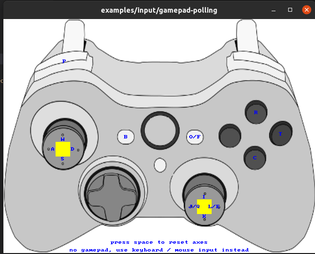

# Lejulab_ARM

[](https://opensource.org/licenses/MIT)
[](https://ubuntu.com/)
[](https://isocpp.org/)


乐聚人形机器人控制与强化学习部署平台，支持 Roban 2.2 ARM64/RK3588 平台。

## 功能

- Roban 2.2 实机控制
- RL、Mimic、Dummy、键盘控制器
- 手柄输入与自启动
- DDS 通信、数据录制和系统监控
- CAN、电机标定和诊断工具
- LejuSDK 控制接口与示例

```text
手柄 / VR → ControllerManager → LejuSDK + DDS → 实机硬件
```

`ROBOT_VERSION` 固定为 `17`，编译和启动前都要设置。已写入当前用户 `~/.bashrc` 并重新加载后，后续命令不用再写一遍。

## 目录结构

```text
src/
├── leju_assets/            # URDF、MJCF、场景和机器人资源
├── leju-controllers/       # RL、Dummy、键盘控制器
├── leju-hardware/          # 硬件节点、CAN、IMU 和设备配置
├── leju-joystick/          # 手柄输入与自启动服务
├── leju_launch/            # DDS 配置和 Shell 启动脚本
├── leju-audio/             # 音频采集与播放
├── leju-monitor/           # 系统状态监控
└── lejusdk/                # SDK、DDS 通信、录制工具和示例
```

## 编译

在 RK3588 上操作，推荐安装可选构建工具：

```bash
sudo apt install -y ccache ninja-build
```

然后在仓库根目录编译：

```bash
export ROBOT_VERSION=17
mkdir -p build
cd build
cmake ..
make -j$(nproc)
```

常用 CMake 开关如下，快速使用保持默认值即可：

| 选项 | 默认值 | 说明 |
|---|---:|---|
| `BUILD_RL_CONTROLLER` | `ON` | 构建 RL 控制器 |
| `BUILD_JOYSTICK` | `ON` | 构建手柄模块 |
| `BUILD_EXAMPLES` | `ON` | 构建示例 |
| `BUILD_TESTING` | `ON` | 构建测试 |
| `BUILD_VR_CONTROL` | `ON` | Quest3 VR 链路（`leju-ik`、`leju-remote`、`quest_vr_*` 节点），需 Drake；`scripts/cmake_configure.sh` 默认开启，`LEJU_BUILD_VR_CONTROL=OFF` 可关闭 |

需要 `quest_vr_control_node` / `quest_vr_abs_control_node` 时，必须先确认配置阶段没有
`Drake not found; BUILD_VR_CONTROL=OFF`，否则 VR 节点不会生成。

编译产物在 `build/`。`build/` 和 `build_cmake/` 里都有硬件程序时，启动脚本先用 `build_cmake/`。按上面的命令编译、且没有 `build_cmake/` 时，用的就是 `build/`。

```text
<build-dir>/
├── src/leju-hardware/leju-hardware
├── src/leju-controllers/leju-dummy-controller/run_dummy_controller
├── src/lejusdk/lejusdk-recorder/recorder/lejusdk_recorder
└── src/.../*.so
```

## 手柄自启动

后面的命令都在仓库根目录执行。编译结束后如果还在 `build/` 里，先返回：

```bash
cd ..
```

实机首次使用时部署手柄自启动服务。脚本会编译工作区并安装服务；已有现场手柄配置时，按终端提示选择是否覆盖。

```bash
# ~/.bashrc 里已经设置 ROBOT_VERSION=17 时：
sudo bash src/leju-joystick/services/deploy_joy_autostart.sh

# 仅本次临时设置时（sudo 不会带走普通 export）：
sudo env ROBOT_VERSION=17 bash src/leju-joystick/services/deploy_joy_autostart.sh
```

```bash
systemctl status lejulab_joy_monitor.service
```

## 运行

真机用 root 运行。进入 root shell 后重新设置 `ROBOT_VERSION`，不要依赖 `sudo -E` 传递 `LD_LIBRARY_PATH`。

启动前确认急停可用、机器人周围无人。

还没有部署过手柄自启动时，先配置共享内存，否则 RouDi 未运行时启动会失败。手柄自启动脚本会顺带做这一步，做过就可以跳过：

```bash
sudo bash src/leju_launch/scripts/setup_cyclonedds_config.sh
```

```bash
sudo su
export ROBOT_VERSION=17
bash src/leju_launch/scripts/launch_real.sh
```

`launch_real.sh` 会拉起硬件、手柄、RL 控制器和录制。单电机调试用 `launch_keyboard_ctrl.sh`，见下文。

### 首次运行

- 出厂机器人通常已完成零点标定。准备站立时关节角和零点有偏差，或更换过电机，再用[电机零点标定工具](./docs/howto-use-motor-cali-tool.md)重标。
- 固定机器人或使用移位架，确认急停有效后拉起背后的急停按钮。
- 将移位架升起，等待机器人进入膝盖微曲状态。
- 降低移位架，让脚掌刚好接触地面。
- 按手柄 `start` 站立。
- 结束时同时按 `back` + `start` 退出程序。运行中会先下蹲，再退出。

## 控制器与手柄

控制器配置：

```text
src/leju-controllers/leju-rl-controller/config/17/controller_manager.yaml
```

常用控制器包括 AMP 行走、Mimic 动作和保持姿态。修改 `default_controller` 后重新启动。



- `start`：从待机进入站立
- `back` + `start`：退出程序。运行中先下蹲再退出；尚未进入运行时直接退出
- 左摇杆：平移；右摇杆：转向
- 其余按键见 `src/leju-controllers/leju-rl-controller/config/17/teleop_bindings.yaml`，说明见 [手柄使用说明](./docs/howto-use-joystick.md)

### 键盘电机控制

用于单电机调试。操作前把机器人固定好，并确认可以随时急停。

```bash
sudo su
export ROBOT_VERSION=17
bash src/leju_launch/scripts/launch_keyboard_ctrl.sh
```

脚本会启动硬件节点、录制器，并在前台运行 `motor_keyboard_ctrl`。

| 按键 | 功能 | 按键 | 功能 |
|---|---|---|---|
| `0-9`/`a-m` | 选择电机 | `W`/`S` | 位置 +/- |
| `[`/`]` | 步长减半/翻倍 | `Space` | 全部回零 |
| `T` | 正弦测试开关 | `E`/`R` | 正弦幅度 -/+ |
| `F`/`G` | 正弦频率 -/+ | `P` | 打印详细位置 |
| `Q` | 退出（自动回零并失能） | | |

## LejuSDK、录制与可视化

- LejuSDK 入口：[src/lejusdk/README.md](src/lejusdk/README.md)
- MCAP 录制配置：`src/leju_launch/config/recorder.yaml`
- 运行数据：`~/.ros/lejulab/{stdout,mcap,coredumps}`
- Foxglove 布局：`config/foxglove-roban2-layout.json`
- MCAP 分析工具：[scripts/mcap/README.md](scripts/mcap/README.md)
- Controller CLI、SDK 示例位于 `src/lejusdk/examples/`

## 系统诊断

```bash
# 在 RK3588 上做全链路检查
sudo bash scripts/diagnostics/check_all.sh

# 从另一台机器检查这块板
bash scripts/diagnostics/check_all.sh --remote <RK3588_IP>
```

专项检查位于 `scripts/diagnostics/`，覆盖 CAN、DDS、硬件节点、实时环境和电机通信。

## 测试

```bash
cd build
make -j$(nproc)
ctest --output-on-failure
```

## 常用文档

- [交叉编译](docs/howto-cross-compile-docker.md)
- [跨机器 RL/MuJoCo 联调](docs/cross-machine-rl-mujoco-guide.md)
- [手柄使用说明](docs/howto-use-joystick.md)
- [电机零点标定](docs/howto-use-motor-cali-tool.md)
- [CAN 参数工具](docs/howto-use-can-param-tool.md)
- [模型部署](docs/lejulab-model-deployment.md)

## tact 播放结束后保持手臂姿态

在 `src/leju-controllers/leju-rl-controller/config/17/controller_manager.yaml` 顶层设置，重启控制器后生效：

```yaml
tact_player:
  hold_after_tact: true  # true：播完保持；false：播完回正（缺省值）
```

动作最后一帧应为希望保持的姿态。文件内自带的回正动作仍会执行。

## 常见问题

### iceoryx RouDi 未运行

实机通信使用共享内存。首次部署并检查服务：

```bash
sudo bash src/leju_launch/scripts/setup_cyclonedds_config.sh
systemctl status leju-roudi
```

### 双夹爪 VR 扳机控制

两个 Quest VR 控制节点已接入平台夹爪 C++ DDS 接口。配置双侧 lejuclaw 并完成硬件初始化后，
左右扳机控制同侧夹爪，使用显式高频模式；未收到双爪状态时保留原灵巧手路径。
输入断流不会由缓存数据继续刷新夹爪看门狗。详见 [夹爪扩展功能](docs/claw_additional_features.md)。
